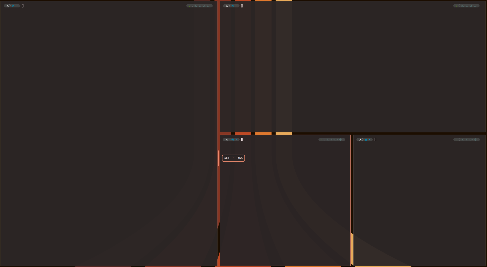

# omarchy-edge-resize

Resize tiled windows in Omarchy by dragging the gap between them, the way you
would drag a split in an editor.

<p align="center">
  
</p>

## What it does

Omarchy turns off Hyprland's `resize_on_border`, so out of the box tiled
windows are resized from the keyboard or with `SUPER` + right-drag, with no
hint of where the edge is or how the space is split. This plugin puts a handle
on every edge shared by two tiled windows of the focused workspace:

- **Hover the gap** between two windows: a pill in your theme's accent colour
  appears and the cursor turns into a resize cursor.
- **Drag it**: both windows resize live, and the pill stays on the real border.
- **See the split** while you drag: a label next to the pill shows how much
  each window takes (`65% · 35%`), side by side for a vertical edge and stacked
  for a horizontal one.
- **Release**: the layout settles and the handles follow the new edges.

It works on vertical and horizontal edges alike, including windows in the
middle of the layout. Neither window can be dragged below 25% of the space the
two of them share.

While a drag is in progress the plugin turns off Hyprland's animations, so the
windows don't trail the cursor, and dwindle's `smart_resizing`, so Hyprland
always moves the edge you grabbed. Both are put back to their previous values
as soon as you release.

Handles only appear where they make sense:

- between tiled windows separated by a gap of up to 40 px that overlap by more
  than 60 px along the edge;
- never on floating windows;
- not at all while a window on the workspace is fullscreen.

## Requirements

- Omarchy 4 with its bundled Quickshell plugin host
- Hyprland with the Lua configuration API (tested with 0.56.2)
- `hyprctl`, included with Hyprland

## Install

```bash
omarchy plugin add https://github.com/daniolivet/omarchy-edge-resize.git --enable
```

The plugin has no settings: once it is enabled, hover the gap between two
tiled windows.

## Limitations

- Only one monitor is supported. The handles use Hyprland's global layout
  coordinates, which only match the screen when it is the only one.
- Tested with the dwindle layout.

## Development

```
Edges.qml                    entry point: keeps the edges up to date, one handle per edge
components/EdgeHandle.qml    the draggable handle over one edge
components/HandlePill.qml    the pill
components/ShareLabel.qml    the live percentage label
services/HyprlandBridge.qml  everything that talks to Hyprland
lib/EdgeGeometry.js          finds the shared edges; plain JavaScript, no QML
```

The edge detection is tested against real layouts captured from Hyprland:

```bash
tests/run.sh                                # run the tests
tests/capture-fixture.sh <name> [workspace] # save a layout as a new fixture
UPDATE_SNAPSHOTS=1 tests/run.sh             # rewrite the expected edges
```

Omarchy reloads the plugin automatically when a file changes.
